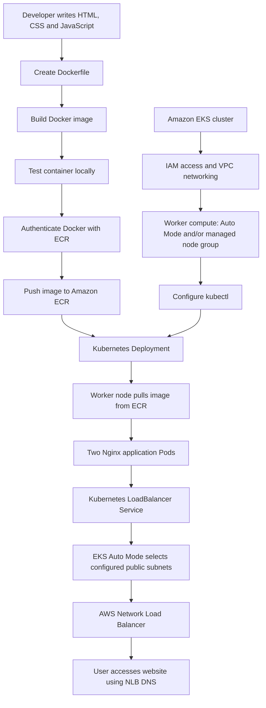

# End-to-End DevOps Project: Deploying a Website on AWS EKS using Docker, ECR and Kubernetes


## 1. Project Overview

**Project:** HTML Website Deployment on Amazon EKS using Amazon ECR

**Objective:** Build a website using HTML, CSS and JavaScript, package it with Docker and Nginx, push the Docker image to Amazon Elastic Container Registry (ECR), and deploy it on Amazon Elastic Kubernetes Service (EKS) using Kubernetes.

The application is exposed to the internet through a Kubernetes `LoadBalancer` Service and an AWS Network Load Balancer (NLB) provisioned by EKS Auto Mode.

### Technologies Used

| Technology | Purpose |
|---|---|
| HTML, CSS, JavaScript | Frontend website |
| Nginx | Web server |
| Docker | Containerization |
| Amazon ECR | Private Docker image registry |
| Amazon EKS | Managed Kubernetes service |
| Kubernetes | Container orchestration |
| AWS EC2 | Administration and deployment machine |
| AWS IAM | Identity and permissions |
| AWS VPC | Network isolation |
| AWS Elastic Load Balancing | Public application access |
| AWS CLI | AWS resource management |
| kubectl | Kubernetes cluster management |

### AWS Environment

| Setting | Value |
|---|---|
| AWS Account | `757957162256` |
| Region | `ap-south-1` (Mumbai) |
| ECR Repository | `mywebsite-ecr` |
| ECR Image Tag | `latest` |
| EKS Cluster | `mywebsite-eks` |
| Kubernetes Version | `1.37` |
| VPC | `vpc-0cf08d6c401575d41` |
| EC2 IAM Role | `EC2-ECR-Push-Role` |
| EKS Auto Mode Node Role | `AmazonEKSAutoNodeRole` |
| Managed Node Group | `mywebsite-nodegroup` |

> **Security note:** This README includes the AWS account ID and resource identifiers from the lab. Review them before publishing the repository publicly. Never commit access keys, secret keys, passwords, kubeconfig credentials, or other secrets.

---

## 2. Project Architecture



### Request flow

1. A developer creates the website files.
2. Docker builds an image containing Nginx and the website files.
3. The image is pushed to the private ECR repository.
4. EKS provides the managed Kubernetes control plane.
5. Worker compute provides CPU and memory for Kubernetes workloads.
6. A Kubernetes Deployment maintains two application Pods.
7. Worker nodes pull the required image from ECR.
8. A Kubernetes Service selects the Pods and provides a stable endpoint.
9. EKS Auto Mode provisions an internet-facing AWS Network Load Balancer.
10. Users access the website through the NLB DNS hostname.

---

## 3. Prerequisites

Before starting, ensure the administration EC2 instance has the required tools:

- AWS CLI
- Docker
- kubectl
- IAM instance profile attached to the EC2 instance
- Network connectivity to AWS APIs and the EKS cluster endpoint

Check the installed tools:

```bash
aws --version
docker --version
kubectl version --client
```

Check the AWS identity used by the EC2 instance:

```bash
aws sts get-caller-identity
```

The project used the `EC2-ECR-Push-Role` IAM role for AWS administration tasks.

---

## 4. Step 1 — Create the HTML Website

Create the project directory:

```bash
mkdir ECR-to-EKS-deployment
cd ECR-to-EKS-deployment
```

Create the frontend file:

```bash
vi index.html
```

Example HTML:

```html
<!DOCTYPE html>
<html lang="en">
<head>
    <meta charset="UTF-8">
    <meta name="viewport" content="width=device-width, initial-scale=1.0">
    <title>My DevOps Website</title>

    <style>
        body {
            margin: 0;
            font-family: Arial, sans-serif;
            background: #101827;
            color: white;
            text-align: center;
        }

        header {
            padding: 80px 20px;
        }

        h1 {
            font-size: 42px;
            color: #38bdf8;
        }

        p {
            font-size: 18px;
        }

        .card {
            margin: 30px auto;
            padding: 30px;
            max-width: 500px;
            background: #1e293b;
            border-radius: 12px;
        }
    </style>
</head>
<body>
    <header>
        <h1>Welcome to My DevOps Website</h1>
        <p>
            Successfully deployed using Docker,
            Amazon ECR and Amazon EKS.
        </p>
    </header>

    <div class="card">
        <h2>Deployment Status</h2>
        <p>Application is running successfully!</p>
    </div>
</body>
</html>
```

**Why HTML and CSS?**

- HTML defines the structure and content of the website.
- CSS controls the layout, colors, spacing and presentation.
- JavaScript can be added for interactive functionality.

---

## 5. Step 2 — Create the Dockerfile

Create a file named `Dockerfile`:

```bash
vi Dockerfile
```

Configuration:

```dockerfile
FROM nginx:alpine

LABEL maintainer="Jai Sai"

COPY index.html /usr/share/nginx/html/index.html

EXPOSE 80

CMD ["nginx", "-g", "daemon off;"]
```

### Dockerfile explanation

| Instruction | Purpose |
|---|---|
| `FROM nginx:alpine` | Uses a lightweight Nginx base image |
| `LABEL` | Adds metadata to the image |
| `COPY` | Copies the website into Nginx's default web directory |
| `EXPOSE 80` | Documents the port used by the web server |
| `CMD` | Starts Nginx in the foreground |

**Why Nginx?**

Nginx is a lightweight web server that serves the website files over HTTP.

**Why Docker?**

Docker packages the website and its web-server runtime into a reusable image. This makes the application easier to test, distribute and run consistently across environments.

---

## 6. Step 3 — Build and Test the Docker Image

Build the image:

```bash
docker build -t mywebsite-ecr:latest .
```

List local images:

```bash
docker images
```

Run the container locally for testing:

```bash
docker run -d --name mywebsite-test -p 8080:80 mywebsite-ecr:latest
```

Test it from the EC2 instance:

```bash
curl http://localhost:8080
```

If port `8080` is already in use, identify the process:

```bash
sudo ss -lntp | grep :8080
```

Stop and remove the test container when finished:

```bash
docker stop mywebsite-test
docker rm mywebsite-test
```

> `EXPOSE 80` documents the container port. The `-p 8080:80` option maps host port 8080 to container port 80 for this local test.

---

## 7. Step 4 — Create the Amazon ECR Repository

Amazon Elastic Container Registry (ECR) is a managed private registry for container images.

Create the repository:

```bash
aws ecr create-repository \
  --repository-name mywebsite-ecr \
  --region ap-south-1
```

The repository URI used in this project:

```text
757957162256.dkr.ecr.ap-south-1.amazonaws.com/mywebsite-ecr
```

Verify the repository:

```bash
aws ecr describe-repositories \
  --repository-names mywebsite-ecr \
  --region ap-south-1
```

**Why ECR?**

ECR stores the image centrally. The Kubernetes worker compute can pull the image from ECR instead of depending on an image stored only on the administration EC2 instance.

---

## 8. Step 5 — Authenticate Docker with ECR

Run:

```bash
aws ecr get-login-password \
  --region ap-south-1 | docker login \
  --username AWS \
  --password-stdin \
  757957162256.dkr.ecr.ap-south-1.amazonaws.com
```

Expected result:

```text
Login Succeeded
```

**Why authenticate?**

The repository is private. Docker must authenticate before it can push an image to ECR.

---

## 9. Step 6 — Tag and Push the Image to ECR

Tag the local image with the ECR repository URI:

```bash
docker tag mywebsite-ecr:latest \
  757957162256.dkr.ecr.ap-south-1.amazonaws.com/mywebsite-ecr:latest
```

Push the image:

```bash
docker push \
  757957162256.dkr.ecr.ap-south-1.amazonaws.com/mywebsite-ecr:latest
```

Verify the image:

```bash
aws ecr list-images \
  --region ap-south-1 \
  --repository-name mywebsite-ecr
```

The image tag used for this deployment was **`latest`**, not `v1`.

**Why tag the image?**

A tag identifies a particular image reference in a repository. Kubernetes uses the repository URI and tag in the Deployment manifest to identify which image it should run.

> For production workflows, immutable version tags such as a release number or Git commit SHA are generally safer than relying on `latest`.

---

## 10. Step 7 — EKS Cluster Configuration

Amazon Elastic Kubernetes Service (EKS) is AWS's managed Kubernetes service.

Project cluster details:

| Setting | Value |
|---|---|
| Cluster name | `mywebsite-eks` |
| Region | `ap-south-1` |
| Kubernetes version | `1.37` |
| VPC | `vpc-0cf08d6c401575d41` |
| EKS Auto Mode | Enabled |
| Auto Mode node pools | `general-purpose`, `system` |
| Auto Mode node role | `AmazonEKSAutoNodeRole` |
| Auto Mode load balancing | Enabled |

Inspect the cluster:

```bash
aws eks describe-cluster \
  --name mywebsite-eks \
  --region ap-south-1
```

### What is the EKS control plane?

The control plane manages the Kubernetes cluster. It includes the Kubernetes API server, scheduler and control-plane components responsible for maintaining the desired state.

AWS manages the EKS control plane.

---

## 11. Step 8 — Worker Compute and Node Groups

Kubernetes needs worker compute to run application Pods. A worker node provides resources such as CPU and memory, along with the components required to run Kubernetes workloads.

This project had both:

- EKS Auto Mode enabled, with `general-purpose` and `system` node pools.
- A managed node group named `mywebsite-nodegroup`.

These are separate compute mechanisms.

### Managed Node Group

An EKS managed node group is a group of EC2 worker instances managed through EKS. You configure aspects such as instance types, scaling and update settings; AWS manages key node-group lifecycle operations.

### EKS Auto Mode

EKS Auto Mode automates more of the Kubernetes infrastructure operations, including compute provisioning and scaling through configured node pools. It can also manage load-balancing integration when enabled and configured.

### Why do we need worker nodes?

The control plane manages Kubernetes, but it does not run the website container itself. Worker compute provides the resources on which the Nginx Pods execute.

### Is a managed node group mandatory?

No. If EKS Auto Mode is enabled and provides sufficient compute for the workloads, a separate managed node group is not inherently required. The project environment contained both, so verify which nodes actually hosted the application Pods rather than assuming that every Pod ran on the managed node group.

Useful commands:

```bash
kubectl get nodes -o wide
```

For a managed node group:

```bash
aws eks list-nodegroups \
  --cluster-name mywebsite-eks \
  --region ap-south-1
```

---

## 12. Step 9 — IAM Roles and Permissions

AWS Identity and Access Management (IAM) controls which identities can access AWS services and perform actions.

Different roles were used for different responsibilities.

### A. `EC2-ECR-Push-Role`

This role was attached to the EC2 administration instance.

Verify the active identity:

```bash
aws sts get-caller-identity
```

The assumed-role ARN observed during the project was similar to:

```text
arn:aws:sts::757957162256:assumed-role/EC2-ECR-Push-Role/i-0965250870a3c9b7a
```

**Why attach this role?**

It allowed the administration EC2 instance to call AWS APIs without storing long-term access keys on the machine.

Permissions used or added during the project included:

| Permission | Purpose |
|---|---|
| `ecr:GetAuthorizationToken` | Authenticate Docker with ECR |
| `ecr:BatchCheckLayerAvailability` | Check whether image layers exist |
| `ecr:InitiateLayerUpload` | Start uploading image layers |
| `ecr:UploadLayerPart` | Upload image-layer parts |
| `ecr:CompleteLayerUpload` | Complete a layer upload |
| `ecr:PutImage` | Push the image manifest |
| `eks:DescribeCluster` | Retrieve EKS cluster details |
| `ec2:DescribeSubnets` | Inspect VPC subnets |
| `ec2:DescribeVpcs` | Inspect VPC details |
| `ec2:DescribeRouteTables` | Inspect route-table configuration |
| `ec2:DescribeAvailabilityZones` | Inspect Availability Zones |
| `ec2:CreateTags` | Apply the required subnet tags |

The list describes permissions used or added during the lab; it is not an export of the role's complete final policy. In a production environment, follow least privilege and scope permissions to the resources and actions required.

### B. `AmazonEKSAutoNodeRole`

This role was configured for EKS Auto Mode compute.

It provides the AWS permissions needed by Auto Mode-provisioned nodes and related managed operations. It is separate from the EC2 administration role.

### C. EKS Cluster Access Entry

An EKS access entry was configured for:

```text
EC2-ECR-Push-Role
```

The associated access policy was:

```text
AmazonEKSClusterAdminPolicy
```

Scope:

```text
Cluster
```

**Why is this required?**

AWS IAM authentication and Kubernetes authorization are related but distinct:

1. The IAM role identifies the EC2 instance to AWS.
2. The EKS access entry maps that IAM identity into EKS access management.
3. The associated access policy grants Kubernetes administrative permissions within the cluster.

Without suitable EKS authorization, AWS CLI authentication can succeed while `kubectl` operations are still denied.

> Cluster-admin access is broad. For production, use a more restrictive access policy and scope wherever possible.

### D. Worker Node ECR Pull Permissions

The image-push role and the worker-node image-pull role have different responsibilities.

- The administration EC2 role pushes images to ECR.
- Worker compute needs permission to retrieve images from ECR.

Typical ECR read actions include:

- `ecr:GetAuthorizationToken`
- `ecr:BatchGetImage`
- `ecr:GetDownloadUrlForLayer`
- `ecr:BatchCheckLayerAvailability`

The exact role and effective permissions depend on whether the workload runs on an EKS managed node group or EKS Auto Mode compute. Confirm the permissions on the actual node role rather than assuming the EC2 administration role is used to pull images.

---

## 13. Step 10 — Configure kubectl

`kubectl` is the command-line tool used to communicate with the Kubernetes API server.

Configure the kubeconfig for the current Linux user:

```bash
aws eks update-kubeconfig \
  --region ap-south-1 \
  --name mywebsite-eks
```

Expected output resembles:

```text
Added new context arn:aws:eks:ap-south-1:757957162256:cluster/mywebsite-eks
```

Check cluster connectivity:

```bash
kubectl cluster-info
kubectl get nodes
```

**Why do we use both AWS CLI and kubectl?**

- AWS CLI manages AWS resources such as ECR repositories, EKS clusters, IAM-related operations and VPC resources.
- `kubectl` manages Kubernetes resources such as Deployments, Pods and Services.

**Important:** kubeconfig is user-specific. If you switch from `root` to `ec2-user`, configure it for the new user too. Each Linux user has a separate home directory and normally a separate kubeconfig file.

---

## 14. Step 11 — Create the Kubernetes Deployment

Create `deployment.yml`:

```bash
vi deployment.yml
```

Configuration:

```yaml
apiVersion: apps/v1
kind: Deployment

metadata:
  name: mywebsite-deployment

spec:
  replicas: 2

  selector:
    matchLabels:
      app: mywebsite

  template:
    metadata:
      labels:
        app: mywebsite

    spec:
      containers:
        - name: mywebsite
          image: 757957162256.dkr.ecr.ap-south-1.amazonaws.com/mywebsite-ecr:latest

          ports:
            - containerPort: 80
```

Apply the manifest:

```bash
kubectl apply -f deployment.yml
```

Check the Deployment and Pods:

```bash
kubectl get deployments
kubectl get pods -o wide
```

### Deployment YAML explanation

| Configuration | Purpose |
|---|---|
| `apiVersion: apps/v1` | Uses the Kubernetes Deployment API |
| `kind: Deployment` | Creates a Deployment resource |
| `metadata.name` | Names the Deployment |
| `replicas: 2` | Requests two application Pods |
| `selector.matchLabels` | Identifies the Pods managed by the Deployment |
| `template` | Defines the Pod template |
| `template.metadata.labels` | Adds labels used by the Service selector |
| `containers` | Defines the container specification |
| `name` | Names the container |
| `image` | Specifies the image to pull from ECR |
| `containerPort: 80` | Documents the application container port |

### Why two replicas?

Two replicas provide basic redundancy. If a Pod fails, the Deployment controller works to restore the desired replica count. Multiple Pods also allow a Service to distribute traffic across available endpoints.

Two replicas alone do not guarantee high availability: placement across separate nodes or Availability Zones, health probes, resource requests and suitable scaling should also be considered.

---

## 15. Step 12 — Understand Kubernetes Pods

A Pod is the smallest deployable unit in Kubernetes.

Our Deployment requests:

```yaml
replicas: 2
```

Kubernetes therefore maintains two Pods for this application.

Useful commands:

```bash
kubectl get pods -o wide
kubectl describe pod POD_NAME
kubectl logs POD_NAME
```

### Deployment vs Pod

- **Deployment:** Maintains the desired number of application replicas and manages updates.
- **Pod:** Runs the application container or containers.

For this project:

```text
Deployment
   |
   +-- Pod 1 --> Nginx container --> Website files
   |
   +-- Pod 2 --> Nginx container --> Website files
```

---

## 16. Step 13 — Create the Kubernetes LoadBalancer Service

Create `service.yaml`:

```bash
vi service.yaml
```

Configuration:

```yaml
apiVersion: v1
kind: Service

metadata:
  name: mywebsite-service

spec:
  type: LoadBalancer

  selector:
    app: mywebsite

  ports:
    - protocol: TCP
      port: 80
      targetPort: 80
```

Apply:

```bash
kubectl apply -f service.yaml
```

Check:

```bash
kubectl get svc
kubectl describe svc mywebsite-service
```

### Service YAML explanation

| Configuration | Purpose |
|---|---|
| `apiVersion: v1` | Uses the core Kubernetes API |
| `kind: Service` | Creates a Service resource |
| `metadata.name` | Names the Service |
| `type: LoadBalancer` | Requests an external load balancer integration |
| `selector` | Selects Pods with the matching application label |
| `port: 80` | Service port receiving traffic |
| `targetPort: 80` | Container port receiving forwarded traffic |
| `protocol: TCP` | Uses TCP transport |

### Why do we need a Service?

Pods are replaceable and their IP addresses can change. A Service provides a stable virtual endpoint and forwards traffic to the matching Pods.

### Why use `type: LoadBalancer`?

The application needs to be accessible from outside the Kubernetes cluster. The LoadBalancer Service asks the configured AWS integration to provision a load balancer.

---

## 17. Step 14 — EKS Auto Mode Load Balancer and Subnet Configuration

The cluster inspection showed that EKS Auto Mode load balancing was enabled.

The Service showed this load balancer class:

```yaml
loadBalancerClass: eks.amazonaws.com/nlb
```

This indicates that the Service is using the EKS Auto Mode Network Load Balancer integration.

### Why a Network Load Balancer?

An AWS Network Load Balancer operates at Layer 4 and distributes TCP traffic to its targets. This application serves HTTP over TCP port 80.

Traffic path:

```text
Internet
   |
AWS Network Load Balancer
   |
Kubernetes Service
   |
Application Pods
   |
Nginx
   |
index.html
```

### Public subnet IDs

The three subnet IDs selected in this project were:

```text
subnet-0c5d07ed729fadb86
subnet-0b64ec85664747e70
subnet-07f035af6de487d85
```

The subnets were configured with these tags:

```text
kubernetes.io/role/elb = 1
kubernetes.io/cluster/mywebsite-eks = shared
```

**Why subnet tags?**

Subnet tags help the load-balancer integration identify suitable subnets. The `kubernetes.io/role/elb` tag marks subnets for internet-facing load balancers. The cluster tag associates the subnet with the EKS cluster for discovery.

### LoadBalancer annotations

Request an internet-facing load balancer:

```bash
kubectl annotate svc mywebsite-service \
  service.beta.kubernetes.io/aws-load-balancer-scheme=internet-facing \
  --overwrite
```

Explicitly identify the subnets:

```bash
kubectl annotate svc mywebsite-service \
  service.beta.kubernetes.io/aws-load-balancer-subnets=subnet-0c5d07ed729fadb86,subnet-0b64ec85664747e70,subnet-07f035af6de487d85 \
  --overwrite
```

**Why these annotations?**

- `aws-load-balancer-scheme=internet-facing` requests a public load balancer.
- `aws-load-balancer-subnets` specifies the subnet IDs to use.

These settings resolved the subnet selection issue encountered during this project.

---

## 18. Step 15 — Verify the Website

Check the Pods:

```bash
kubectl get pods -o wide
```

Check the Deployment:

```bash
kubectl get deployment mywebsite-deployment
```

Check the Service:

```bash
kubectl get svc mywebsite-service
```

Watch load-balancer provisioning:

```bash
kubectl get svc mywebsite-service -w
```

When provisioning completes, the Service should show an external hostname in the `EXTERNAL-IP` column. Retrieve it with:

```bash
kubectl get svc mywebsite-service \
  -o jsonpath='{.status.loadBalancer.ingress[0].hostname}'; echo
```

Open the returned hostname in a browser:

```text
http://YOUR-AWS-NLB-DNS
```

The exact NLB DNS hostname is not included in this documentation; retrieve it from the live Service status.

---

## 19. Troubleshooting and Resolutions

The following issues were encountered during the implementation. These are useful examples for technical discussions and interviews.

### Issue 1 — Docker host port 8080 already in use

**Error:**

```text
failed to bind host port 0.0.0.0:8080:
address already in use
```

**Root cause:** Another process was already listening on host port 8080.

**Investigation:**

```bash
sudo ss -lntp | grep :8080
```

**Resolution:** Identify the process and stop it safely if appropriate, or map a different host port, for example:

```bash
docker run -d --name mywebsite-test -p 8081:80 mywebsite-ecr:latest
```

**Why did this happen?** A host IP and port combination cannot be bound by multiple processes at the same time.

### Issue 2 — ECR image tag mismatch

**Problem:** The Deployment referenced `v1`, but the ECR repository contained the `latest` tag.

**Verify available tags:**

```bash
aws ecr list-images \
  --region ap-south-1 \
  --repository-name mywebsite-ecr
```

**Resolution:**

```bash
kubectl set image deployment/mywebsite-deployment \
  mywebsite=757957162256.dkr.ecr.ap-south-1.amazonaws.com/mywebsite-ecr:latest
```

Check rollout status:

```bash
kubectl rollout status deployment/mywebsite-deployment
```

**Why did this happen?** Kubernetes needs an image reference that exists in the registry. A repository containing `latest` does not automatically contain a `v1` tag.

### Issue 3 — `ImagePullBackOff`

**Observed status:**

```text
ImagePullBackOff
```

**Root cause in this project:** The Deployment requested an image tag that was not present in ECR.

**Resolution:** Corrected the image reference from `v1` to `latest`.

**General troubleshooting note:** `ImagePullBackOff` can also be caused by an incorrect image URI, missing ECR pull permissions, expired or unavailable credentials, or network connectivity problems. Always inspect the Pod events:

```bash
kubectl describe pod POD_NAME
```

### Issue 4 — kubectl attempted to connect to localhost:8080

**Error:**

```text
The connection to the server localhost:8080 was refused
```

**Root cause:** We switched from the `root` user to `ec2-user`. The kubeconfig existed under the root user's home directory, not the ec2-user home directory.

**Resolution:** Run the following command as the user who will run kubectl:

```bash
aws eks update-kubeconfig \
  --region ap-south-1 \
  --name mywebsite-eks
```

Then verify:

```bash
kubectl get nodes
```

**Why did this happen?** Linux users have separate home directories and kubeconfig files. A kubeconfig created for one user is not automatically available to another.

### Issue 5 — Worker node showed `NotReady`

**Observed node statuses included:**

```text
Ready
Ready
NotReady
```

The NotReady node reported:

```text
NetworkPluginNotReady:
cni plugin not initialized
```

**Root cause indicated by the message:** The node's Kubernetes networking plugin had not initialized successfully.

**Why is CNI important?** CNI stands for Container Network Interface. It provides the networking setup that allows Kubernetes Pods to communicate.

During investigation, no `aws-node` Pods were visible in `kube-system` at that stage. Later output showed two Ready nodes. The earlier NotReady node should be investigated separately if it is still present; do not assume that it was fixed merely because two other nodes were Ready.

Useful checks:

```bash
kubectl get nodes -o wide
kubectl get pods -n kube-system -o wide
kubectl get events -A --sort-by=.lastTimestamp
```

### Issue 6 — IAM `UnauthorizedOperation` for `ec2:DescribeSubnets`

**Error:**

```text
not authorized to perform:
ec2:DescribeSubnets
```

**Root cause:** The EC2 instance role did not have the permission required to inspect subnet details.

**Resolution:** Added the required `ec2:DescribeSubnets` permission to the administration role, along with other required read permissions.

**Why was it needed?** We needed to inspect subnet IDs, Availability Zones, CIDR ranges, available IP addresses and tags while troubleshooting load-balancer subnet discovery.

### Issue 7 — IAM `UnauthorizedOperation` for `ec2:CreateTags`

**Error:**

```text
not authorized to perform:
ec2:CreateTags
```

**Root cause:** The EC2 role could inspect subnet details but could not modify subnet tags.

**Resolution:** Added `ec2:CreateTags` permission scoped to the required subnet resources, then applied the tags:

```bash
aws ec2 create-tags \
  --region ap-south-1 \
  --resources \
  subnet-0c5d07ed729fadb86 \
  subnet-0b64ec85664747e70 \
  subnet-07f035af6de487d85 \
  --tags \
  Key=kubernetes.io/role/elb,Value=1 \
  Key=kubernetes.io/cluster/mywebsite-eks,Value=shared
```

**Why was it needed?** The subnets needed the appropriate tags so the load-balancer integration could discover eligible public subnets.

### Issue 8 — LoadBalancer remained Pending

**Observed state:**

```text
mywebsite-service   LoadBalancer   ...   <pending>
```

**Controller event:**

```text
FailedBuildModel:
unable to resolve at least one subnet.
Evaluated 0 subnets
```

**Root cause:** The load-balancer controller could not identify eligible subnets.

**Investigation performed:**

1. Checked the EKS VPC ID.
2. Inspected subnet IDs and Availability Zones.
3. Checked available subnet IP addresses.
4. Inspected subnet tags.
5. Checked route-table configuration.
6. Verified EKS Auto Mode load-balancing configuration.
7. Inspected the Service's `loadBalancerClass`.

The subnets initially had no tags:

```json
"Tags": null
```

**Resolution:** Added the required public load-balancer and cluster tags, then applied the internet-facing and explicit-subnet Service annotations described in Section 17.

This resolved the subnet selection problem and the load balancer was successfully provisioned.

---

## 20. Useful Command Reference

### Docker

```bash
docker build -t mywebsite-ecr:latest .
docker images
docker ps
docker logs CONTAINER_NAME
docker stop CONTAINER_NAME
docker rm CONTAINER_NAME
```

### ECR

```bash
aws ecr describe-repositories \
  --repository-names mywebsite-ecr \
  --region ap-south-1

aws ecr list-images \
  --repository-name mywebsite-ecr \
  --region ap-south-1
```

### EKS

```bash
aws eks describe-cluster \
  --name mywebsite-eks \
  --region ap-south-1

aws eks update-kubeconfig \
  --region ap-south-1 \
  --name mywebsite-eks

aws eks list-nodegroups \
  --cluster-name mywebsite-eks \
  --region ap-south-1
```

### Kubernetes

```bash
kubectl get nodes -o wide
kubectl get pods -o wide
kubectl get deployments
kubectl get svc
kubectl describe svc mywebsite-service
kubectl describe pod POD_NAME
kubectl logs POD_NAME
kubectl rollout status deployment/mywebsite-deployment
kubectl get events --sort-by=.lastTimestamp
kubectl get pods -n kube-system -o wide
```

---

## 21. Important DevOps Concepts Learned

| Concept | What it means |
|---|---|
| Containerization | Packaging an application and its runtime into a container image |
| Image registry | Storing and distributing images through Amazon ECR |
| Kubernetes Deployment | Maintaining the desired number of Pods and managing updates |
| Pod | The smallest deployable Kubernetes unit |
| Service | Providing a stable endpoint for accessing matching Pods |
| LoadBalancer | Exposing an application through an external load balancer |
| IAM | Managing AWS identities and permissions |
| VPC | Providing an isolated virtual network |
| Subnet | Dividing a VPC network into smaller IP ranges |
| Route table | Controlling where network traffic is routed |
| CNI | Providing Kubernetes Pod networking |
| Node group | Providing worker compute capacity |
| EKS Auto Mode | Automating supported Kubernetes infrastructure operations |
| NLB | Distributing network traffic at Layer 4 |

---

## 22. Two-Minute Interview Explanation

> I developed a frontend website using HTML and CSS and containerized it using Docker, with Nginx as the web server.
>
> I created a private Amazon ECR repository and pushed the Docker image to ECR. Next, I used an Amazon EKS cluster with EKS Auto Mode enabled. I configured IAM roles and an EKS access entry so that my EC2 administration instance could interact with the cluster.
>
> I created a Kubernetes Deployment with two replicas, referencing the image stored in ECR. The worker compute pulled the image and started the Nginx application Pods.
>
> I then created a Kubernetes Service of type LoadBalancer to expose the application externally. EKS Auto Mode provisioned an AWS Network Load Balancer.
>
> During implementation, I troubleshot an ImagePullBackOff issue caused by an incorrect image tag. I corrected the image reference from `v1` to `latest`. I also resolved a load-balancer subnet discovery issue by adding the required subnet tags and explicitly specifying the public subnet IDs through Service annotations.
>
> Finally, the load balancer was provisioned successfully, making the website accessible through its external DNS hostname.

---

## 23. Final Architecture Summary

```text
HTML / CSS / JavaScript
          |
          v
       Dockerfile
          |
          v
      Docker Image
          |
          v
      Amazon ECR
          |
          v
      Amazon EKS
          |
          v
 Kubernetes Deployment
          |
          v
      Two Pods
          |
          v
     Nginx Containers
          |
          v
 Kubernetes LoadBalancer Service
          |
          v
 AWS Network Load Balancer
          |
          v
    Public Website URL
```

### Project Outcome

A containerized frontend application was deployed on Amazon EKS, using:

- Docker to package the website.
- Amazon ECR to store the container image.
- Amazon EKS and Kubernetes to orchestrate the application.
- IAM roles and EKS access management to control permissions.
- EKS Auto Mode and public subnet configuration to provision the load balancer.
- AWS Network Load Balancer to provide external application access.

---

## 24. Possible Future Improvements

The following are potential next steps, not features claimed as already implemented:

- Add a CI/CD pipeline using GitHub Actions or Jenkins.
- Use immutable image tags based on Git commit IDs.
- Add Kubernetes readiness and liveness probes.
- Define CPU and memory requests and limits.
- Configure Horizontal Pod Autoscaler (HPA).
- Add HTTPS using a TLS certificate and an appropriate ingress or load-balancer configuration.
- Add monitoring and alerting using Prometheus and Grafana or AWS monitoring services.
- Store Kubernetes manifests in Git and introduce a GitOps workflow.
- Review IAM policies and replace broad permissions with least-privilege policies.

---

## Author

**Jai Sai**

Cloud / DevOps Engineer

- GitHub: [jaisaikumar002-debug](https://github.com/jaisaikumar002-debug)
- LinkedIn: [Attada Jai Sai Kumar](https://www.linkedin.com/in/attada-jaisaikumar)

